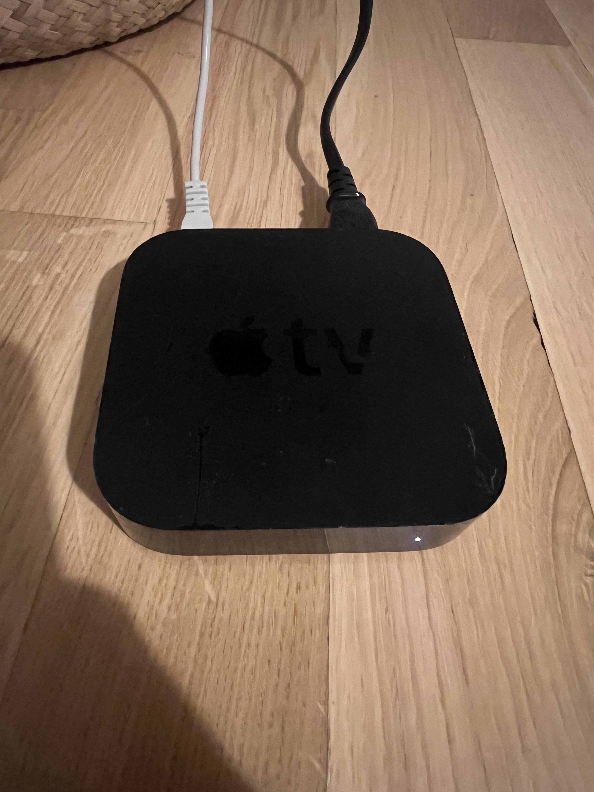

# n8n for Apple TV 3

This repository provides a complete n8n installation for an Apple TV 3,2
running jailbroken iPhone OS 8.4.4 (Darwin 14, 32-bit ARMv7). It contains the
tested runtime, installation scripts, and the files required to reproduce the
custom Node.js build.

## Hardware



*The tested Apple TV 3, connected by Ethernet and HDMI.*

## n8n interface


*n8n 0.110.0 running locally on the Apple TV 3.*

## Included components

- Custom ARMv7/iOS 8 Node.js 12.19.0 binary
- npm 6.14.8
- n8n 0.110.0 with its resolved dependency tree
- Native ARMv7 `sqlite3` addon
- launchd service and low-memory V8 settings
- Execution-history pruning for the limited device memory
- Optional compatible community nodes
- Patched source files and build toolchain wrappers needed to reproduce
  the Node.js binary
- Installation, verification, security, and blog research notes

No passwords, OAuth tokens, GitHub tokens, Tailscale identity files, n8n
credentials, databases, device/user private keys, or personal workflows are
included. Third-party packages may contain their upstream public example or
test strings.

## Compatibility

| Model number printed on the case | Hardware identifier | Research result |
|---|---|---|
| **A1469**, Apple TV (3rd generation, Rev A) | `AppleTV3,2` | **Verified and supported.** The complete bundle, SQLite addon, launchd service, and optional Tailscale port were tested on this model. |
| **A1427**, Apple TV (3rd generation) | `AppleTV3,1` | **Likely compatible, but not verified.** It is the only other model expected to run this ARMv7/iOS 8 runtime. The installers refuse this identifier until it has passed the validation process below. |
| A1378, Apple TV (2nd generation) | `AppleTV2,1` | **Incompatible with this bundle.** Its final jailbreakable software generation predates iOS 8. The included Node.js binary requires iPhone OS 8.0 or later. The model also has less memory. |
| A1625, Apple TV HD (formerly 4th generation) | `AppleTV5,3` | **Incompatible.** This and later models use the 64-bit tvOS platform. The bundle contains 32-bit ARMv7 Mach-O executables. |
| A1842 and all later Apple TV 4K models | Varies | **Incompatible.** These are 64-bit tvOS devices, not the 32-bit ARMv7/iOS environment targeted here. |
| A1218, Apple TV (1st generation) | `AppleTV1,1` | **Incompatible.** This model uses an Intel platform, not ARMv7. |

Apple lists **A1427** and **A1469** as the two third-generation model numbers in
its [Apple TV identification guide](https://support.apple.com/en-us/101605).
The [Blackb0x jailbreak project](https://github.com/NSSpiral/Blackb0x) lists
both `AppleTV3,1` and `AppleTV3,2` for the 8.4.x jailbreak path. Blackb0x
requires an Arduino and the checkm8-A5 procedure to prepare A1427. The
executables in this repository are generic ARMv7 Mach-O files. The Node.js
binary requires iPhone OS 8.0 or later.

Based on these facts, **A1427 / `AppleTV3,1` is the only additional model
likely to run this bundle**. This is an engineering assessment, not a verified
device test. The project was built and tested on **A1469 / `AppleTV3,2`**. The
model guards therefore continue to block A1427.

### Validation required for A1427

A1427 must pass the following checks on physical hardware before it can be
listed as supported:

1. Confirm iPhone OS 8.4.x, a 32-bit kernel, working SSH, launchd, and `ldid`.
2. Change the model guard only in a local copy. Install it on a disposable
   test device without valuable data.
3. Run `./verify.sh`, create and execute a workflow, and confirm that workflow
   data survives a reboot.
4. Exercise the native SQLite addon and observe memory use during several
   cold starts and at least a 30-minute workflow test.
5. Validate the optional Tailscale port separately. n8n compatibility does
   not prove that its network extension and routing behavior are stable.

## Jailbreak instructions

This repository requires a jailbroken Apple TV. It does not contain a
jailbreak or modified Apple firmware. The upstream
[Blackb0x project](https://github.com/NSSpiral/Blackb0x) provides:

- provides the [current jailbreak instructions](https://github.com/NSSpiral/Blackb0x#steps-to-jailbreak)
- publishes the application on its
  [official releases page](https://github.com/NSSpiral/Blackb0x/releases)
- supports the standard Apple TV 3 process for **A1469 / `AppleTV3,2`**
- requires an Arduino and
  [checkm8-A5](https://github.com/synackuk/checkm8-a5) preparation before its
  normal process for **A1427 / `AppleTV3,1`**. This n8n bundle remains
  unverified on that model.

Always follow the current upstream instructions. Tool requirements and
download links can change. Blackb0x currently instructs users to connect both
Micro-USB and power, enter DFU mode when prompted, and keep the Apple TV
connected to the internet during its first boot. Do not interrupt the first
boot before setup has completed.

Jailbreaking and restoring can erase the device or leave it temporarily
unbootable. Confirm the case model number and use only the matching firmware
and procedure. After the jailbreak, confirm that SSH works and change the
default root password before installing n8n. Jailbreaking may affect warranty,
support, and device security. Check the rules that apply in your country.

## Installation requirements

Use this binary bundle only when all of these are true:

- `uname -a` contains `AppleTV3,2`
- `sw_vers` reports iPhone OS 8.4.4 / build 12H1006 or a demonstrably
  compatible build
- `getconf LONG_BIT` reports `32`
- the device is jailbroken and has SSH, launchd, `ldid`, and at least 700 MB
  free under `/var`

The installer rejects other hardware and 64-bit systems.

## Installation

1. Change the device's default root password before doing anything else:

   ```sh
   ssh -oHostKeyAlgorithms=+ssh-dss root@DEVICE_IP passwd
   ```

2. Unzip this bundle on a Mac. Copy the extracted directory to the device.
   The old SSH server may require legacy host-key negotiation and old-style
   SCP mode:

   ```sh
   scp -O -r -oHostKeyAlgorithms=+ssh-dss \
     legacy-n8n-apple-tv3 root@DEVICE_IP:/var/tmp/
   ```

3. Connect and run the installer:

   ```sh
   ssh -oHostKeyAlgorithms=+ssh-dss root@DEVICE_IP
   cd /var/tmp/legacy-n8n-apple-tv3
   chmod 755 install.sh verify.sh install-community-nodes.sh
   ./install.sh
   ./verify.sh
   ```

4. Open `http://DEVICE_IP:5678/`. The first start can take more than one minute
   while n8n scans its node catalog.

5. Install the tested community-node set if required:

   ```sh
   ./install-community-nodes.sh
   ```

   These nodes increase startup time and memory use.

6. Install Python 3.7.1 if the custom Code node requires it:

   ```sh
   ./install-python3.sh
   ```

7. The ZIP includes custom ARMv7 Tailscale binaries. The main installer does
   not install them. Read `SECURITY.md` and `docs/TAILSCALE-README.md` before
   running the guarded `install-tailscale-experimental.sh` installer.

## Configuration

The installer creates `/var/local/n8n-config/env.sh`. Edit this file to change
the public host or webhook URL. Then restart the service:

```sh
launchctl unload /Library/LaunchDaemons/com.n8n.server.plist
launchctl load /Library/LaunchDaemons/com.n8n.server.plist
```

The default webhook base is `http://n8n.local:5678/`. Change it only when a
separate trusted reverse proxy is available.

## Remote access with Tailscale (experimental)

The bundle includes the custom ARMv7 Tailscale client tested on A1469. After
installation and authorization, approved devices in the same tailnet can
access n8n and SSH from outside the Apple TV's internal network:

```sh
./install-tailscale-experimental.sh --i-understand-experimental
tailscale-device login
tailscale-device status
```

Open the authorization URL printed by `tailscale-device login`. Approve the
Apple TV in Tailscale and obtain its Tailscale IPv4 address from `status`.
Clients in the same tailnet can then use:

```text
n8n: http://TAILSCALE_IP:5678/
SSH: ssh -oHostKeyAlgorithms=+ssh-dss root@TAILSCALE_IP
```

This configuration provides private tailnet access without publishing n8n or
SSH directly to the internet. The included Tailscale 1.22.2 ARMv7 port is an
unsupported historical compatibility build. Use restrictive tailnet
grants/ACLs and do not configure it as an exit node. For security-sensitive
deployments, use a current VPN gateway on supported hardware. Read
[`docs/TAILSCALE-README.md`](docs/TAILSCALE-README.md) before enabling
Tailscale.

## Important paths

| Purpose | Path |
|---|---|
| Runtime | `/var/local/n8n-runtime` |
| Database and user data | `/var/local/n8n-data/.n8n` |
| Local configuration | `/var/local/n8n-config/env.sh` |
| Community nodes | `/var/local/n8n-community` |
| Service | `/Library/LaunchDaemons/com.n8n.server.plist` |
| Logs | `/var/local/n8n-data/n8n.log` and `n8n-error.log` |

The installer stores the runtime under `/var`. The root filesystem has only
about 1.4 GB, while the data partition provides more space.

## Before importing workflows

- Create credentials in the new n8n instance. Never copy secrets from another
  user's database.
- Back up `/var/local/n8n-data` after initial setup and before changes.
- Keep execution history short. The service saves failures, skips successful
  execution payloads, and runs an additional pruning job.
- Do not start a second n8n CLI process while the server is running. On this
  512 MB-class device, loading two n8n processes can trigger memory pressure
  and a launchd restart.

## Further documentation

- Read [SECURITY.md](SECURITY.md) before exposing the service to any network.
- Review the technical reconstruction in
  [docs/BUILD-HISTORY.md](docs/BUILD-HISTORY.md).
- Find the compatible device packages in
  [docs/DEVICE-PACKAGES.md](docs/DEVICE-PACKAGES.md).
- Use [docs/BLOG-ARTICLE-OUTLINE.md](docs/BLOG-ARTICLE-OUTLINE.md) as the basis
  for a blog article.
