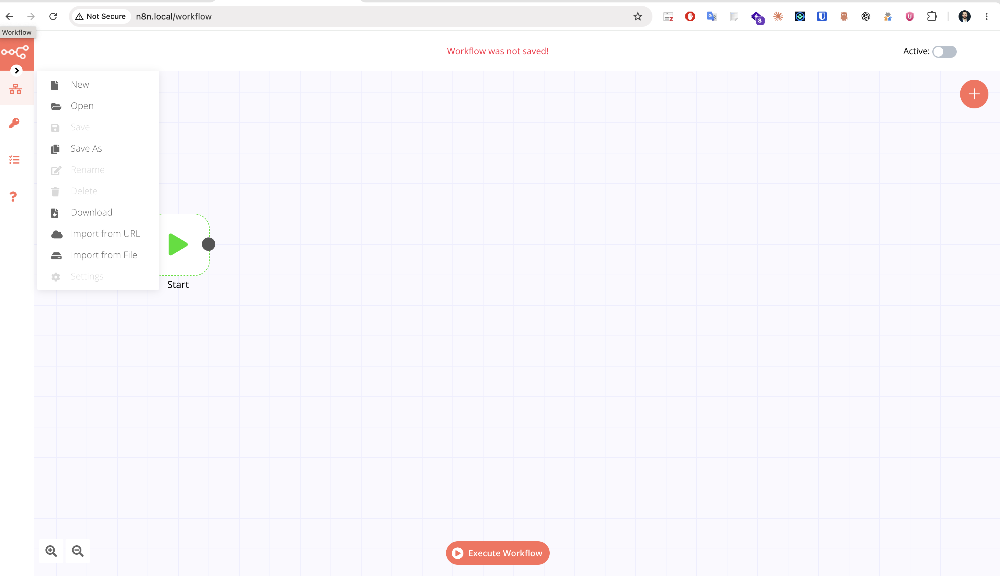

# Legacy n8n appliance for Apple TV 3

This bundle reproduces the working n8n installation built for an Apple TV 3,2
running jailbroken iPhone OS 8.4.4 (Darwin 14, 32-bit ARMv7).

## Hardware


*The Apple TV 3 used for the legacy n8n appliance, connected by Ethernet and HDMI.*

## n8n interface



*The legacy n8n workflow editor running locally on the Apple TV 3.*

It contains a ready-to-install runtime, not just instructions:

- custom ARMv7/iOS 8 Node.js 12.19.0 binary;
- npm 6.14.8;
- n8n 0.110.0 with its resolved dependency tree;
- native ARMv7 `sqlite3` addon;
- launchd service and low-memory V8 settings;
- execution-history pruning for the small device;
- optional compatible community nodes;
- the patched source files and build toolchain wrappers needed to reproduce
  the Node binary;
- installation, verification, security, and blog-research notes.

No passwords, OAuth tokens, GitHub tokens, Tailscale identity files, n8n
credentials, databases, device/user private keys, or personal workflows are
included. Third-party packages may contain their upstream public example or
test strings.

## Supported target

### Compatibility research

| Model number printed on the case | Hardware identifier | Research result |
|---|---|---|
| **A1469** — Apple TV (3rd generation, Rev A) | `AppleTV3,2` | **Verified and supported.** This is the device on which the complete bundle, SQLite addon, launchd service, and optional Tailscale port were tested. |
| **A1427** — Apple TV (3rd generation) | `AppleTV3,1` | **Strong candidate, but unverified.** It is the only other model likely to run the ARMv7/iOS 8 runtime. The current installers deliberately refuse it until somebody completes the validation checklist below. |
| A1378 — Apple TV (2nd generation) | `AppleTV2,1` | **Incompatible with this bundle.** Its final jailbreakable software generation predates iOS 8, while the included Node binary declares iPhone OS 8.0 as its minimum. It also has substantially less memory. |
| A1625 — Apple TV HD (formerly 4th generation) | `AppleTV5,3` | **Incompatible.** This and later Apple TV models use the 64-bit tvOS platform; this bundle contains 32-bit ARMv7 Mach-O executables. |
| A1842 and all later Apple TV 4K models | Varies | **Incompatible.** These are 64-bit tvOS devices, not the 32-bit ARMv7/iOS environment targeted here. |
| A1218 — Apple TV (1st generation) | `AppleTV1,1` | **Incompatible.** It is an Intel-based platform, not ARMv7. |

Apple lists **A1427** and **A1469** as the two third-generation model numbers in
its [Apple TV identification guide](https://support.apple.com/en-us/101605).
The [Blackb0x jailbreak project](https://github.com/NSSpiral/Blackb0x) also
lists both `AppleTV3,1` and `AppleTV3,2` on the 8.4.x jailbreak path. A1427 is
more difficult to prepare: Blackb0x says that it first requires an Arduino and
the checkm8-A5 procedure. The executables in this repository are generic
ARMv7 Mach-O files, and the Node binary has a minimum deployment target of
iPhone OS 8.0. Together, those facts make **A1427 / `AppleTV3,1` the only
credible additional candidate** for this exact bundle.

That conclusion is an engineering inference, not a successful device test.
This project was built and verified specifically on **A1469 / `AppleTV3,2`**,
and the model guards have intentionally not been weakened. Do not describe
A1427 as supported until it passes all of these checks on real hardware:

1. Confirm iPhone OS 8.4.x, a 32-bit kernel, working SSH, launchd, and `ldid`.
2. Install into a disposable test device after changing the model guard in a
   local copy; do not bypass it on a device containing valuable data.
3. Run `./verify.sh`, create and execute a workflow, and confirm that workflow
   data survives a reboot.
4. Exercise the native SQLite addon and observe memory use during several
   cold starts and at least a 30-minute workflow test.
5. Validate the optional Tailscale port separately; n8n compatibility does
   not prove that its network extension and routing behavior are stable.

## Jailbreak instructions

This repository starts **after** the Apple TV has been jailbroken; it does not
contain a jailbreak or modified Apple firmware. Instructions and downloads for
the supported 8.4.x jailbreak path are maintained by the upstream
[Blackb0x project](https://github.com/NSSpiral/Blackb0x):

- read the [Blackb0x instructions](https://github.com/NSSpiral/Blackb0x#steps-to-jailbreak);
- obtain the application from its
  [official releases page](https://github.com/NSSpiral/Blackb0x/releases);
- for **A1469 / `AppleTV3,2`**, follow the normal Blackb0x Apple TV 3 process;
- for **A1427 / `AppleTV3,1`**, Blackb0x additionally requires an Arduino and
  [checkm8-A5](https://github.com/synackuk/checkm8-a5) preparation before its
  normal steps. This n8n bundle remains unverified on that model.

Follow the upstream instructions rather than a copied version in a blog post,
because tool requirements and download links can change. At the time of this
research, Blackb0x instructs users to connect both Micro-USB and power, enter
DFU mode when prompted, keep the Apple TV connected to the internet for its
first boot, and not interrupt that first boot until setup has completed.

Jailbreaking and restoring can erase the device or leave it temporarily
unbootable. Confirm the case model number first, use only the matching firmware
and procedure, and accept the risk before continuing. After the jailbreak,
confirm that SSH works and change the default root password before installing
n8n. Jailbreaking may also affect warranty, support, and device security; check
the rules that apply in your country.

Use this binary bundle only when all of these are true:

- `uname -a` contains `AppleTV3,2`;
- `sw_vers` reports iPhone OS 8.4.4 / build 12H1006 or a demonstrably
  compatible build;
- `getconf LONG_BIT` reports `32`;
- the device is jailbroken and has SSH, launchd, `ldid`, and at least 700 MB
  free under `/var`.

The installer refuses other hardware and 64-bit systems.

## Fast installation

1. Change the device's default root password before doing anything else:

   ```sh
   ssh -oHostKeyAlgorithms=+ssh-dss root@DEVICE_IP passwd
   ```

2. Unzip this bundle on a Mac. Copy the extracted directory to the device.
   The old SSH server may require legacy host-key negotiation and old-style
   SCP mode:

   ```sh
   scp -O -r -oHostKeyAlgorithms=+ssh-dss \
     legacy-n8n-apple-tv3 root@DEVICE_IP:/var/tmp/
   ```

3. Connect and run the installer:

   ```sh
   ssh -oHostKeyAlgorithms=+ssh-dss root@DEVICE_IP
   cd /var/tmp/legacy-n8n-apple-tv3
   chmod 755 install.sh verify.sh install-community-nodes.sh
   ./install.sh
   ./verify.sh
   ```

4. Open `http://DEVICE_IP:5678/`. The first start can take more than one
   minute while n8n scans its node catalog.

5. Optional: install the tested community-node set:

   ```sh
   ./install-community-nodes.sh
   ```

   This makes startup slower and increases memory use. Install it only if the
   included nodes are needed.

6. Optional Python 3.7.1 for the custom Code node:

   ```sh
   ./install-python3.sh
   ```

7. The ZIP also preserves the custom ARMv7 Tailscale binaries. They are not
   installed by default. Read `SECURITY.md` and `docs/TAILSCALE-README.md`; the
   guarded installer is `install-tailscale-experimental.sh`.

## Configuration

The first installation creates `/var/local/n8n-config/env.sh`. Edit it to
change the public host or webhook URL, then restart:

```sh
launchctl unload /Library/LaunchDaemons/com.n8n.server.plist
launchctl load /Library/LaunchDaemons/com.n8n.server.plist
```

The default webhook base is `http://n8n.local:5678/`. Change it only if you
install a separate trusted reverse proxy.

## Remote access with Tailscale (experimental)

The bundle includes the custom ARMv7 Tailscale client used on the verified
Apple TV. After installation and authorization, approved devices in the same
tailnet can reach n8n and SSH while away from the Apple TV's internal network:

```sh
./install-tailscale-experimental.sh --i-understand-experimental
tailscale-device login
tailscale-device status
```

Open the authorization URL printed by `tailscale-device login`, approve the
Apple TV in Tailscale, and obtain its Tailscale IPv4 address from `status`.
Remote clients connected to the same tailnet can then use:

```text
n8n: http://TAILSCALE_IP:5678/
SSH: ssh -oHostKeyAlgorithms=+ssh-dss root@TAILSCALE_IP
```

This provides private tailnet access; it does not require publishing n8n or
SSH directly to the public internet. The included Tailscale 1.22.2 ARMv7 port
is an unsupported historical compatibility build, however. Use restrictive
tailnet grants/ACLs, do not use it as an exit node, and prefer a current VPN
gateway on supported hardware for security-sensitive deployments. Read
[`docs/TAILSCALE-README.md`](docs/TAILSCALE-README.md) before enabling it.

Important paths:

| Purpose | Path |
|---|---|
| Runtime | `/var/local/n8n-runtime` |
| Database and user data | `/var/local/n8n-data/.n8n` |
| Local configuration | `/var/local/n8n-config/env.sh` |
| Community nodes | `/var/local/n8n-community` |
| Service | `/Library/LaunchDaemons/com.n8n.server.plist` |
| Logs | `/var/local/n8n-data/n8n.log` and `n8n-error.log` |

The runtime is intentionally stored under `/var`: the root filesystem is only
about 1.4 GB, while the data partition has materially more room.

## Before importing workflows

- Create credentials again in the new n8n instance. Never copy secrets from
  another user's database.
- Back up `/var/local/n8n-data` after initial setup and before changes.
- Keep execution history short. The supplied service saves failures, skips
  successful execution payloads, and runs an additional pruning job.
- Do not start a second n8n CLI process while the server is running. On this
  512 MB-class device, loading two n8n processes can trigger memory pressure
  and a launchd restart.

Read [SECURITY.md](SECURITY.md) before exposing the service to any network.
The technical reconstruction is in [docs/BUILD-HISTORY.md](docs/BUILD-HISTORY.md),
the compatible device packages are catalogued in
[docs/DEVICE-PACKAGES.md](docs/DEVICE-PACKAGES.md), and a blog-ready outline is
in [docs/BLOG-ARTICLE-OUTLINE.md](docs/BLOG-ARTICLE-OUTLINE.md).
